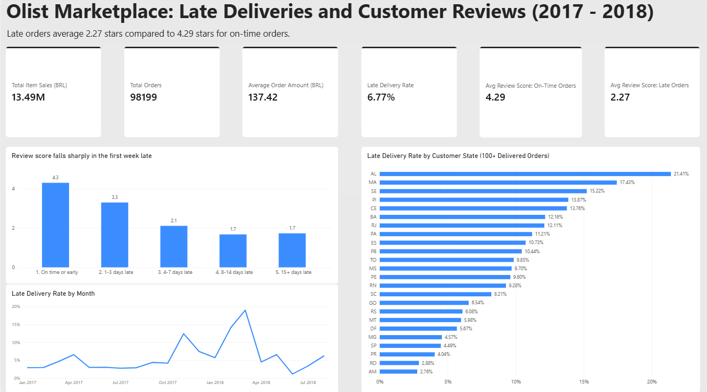
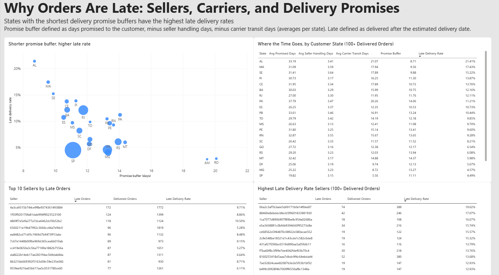

# Olist Marketplace: Late Deliveries and Customer Reviews (2017 - 2018)

## Headline Finding

In the Olist Marketplace dataset from 2017 to 2018 there were 98,199 total orders with an average order amount of 137.42 BRL with about 3% of the customers placing more than one order.

Late orders average 2.27 stars compared to 4.29 stars for on-time orders. Late orders of 1 to 3 days have an average score of 3.29 stars. Orders 4 to 7 days late have an average of 2.11 stars.

The overall late delivery rate for these orders is 6.77% and the states where the customers lived that had the shortest promise buffer (promised delivery days minus the days sellers and carriers take) have the highest late rates.

## Screenshots

Page 1: Delivery & Reviews Overview

Page 2: Why Orders Are Late

## The Question

This project asks where the delivery performance is the weakest, and what is involved in the deliveries. I looked at seller handling time, carrier transit time, and how many days the promised delivery date leaves before an order is considered late. Furthermore, I looked at how much lower reviews are when an order is late.

The original intent was to look at customer retention for Olist, but according to the data only about 3% of the customers made more than one order. This Olist data doesn’t provide a possible explanation as to why customers don’t return, so I turned to delivery and customer satisfaction.

## Data and Method

I used the Olist Brazilian e-commerce dataset which ranges from 2016 to 2018. However, my monthly chart only uses January 2017 to August 2018 since only 297 orders fall outside of that range. I used the following tables: orders, order items, products, sellers, and a date table that I created.

Canceled and Unavailable orders are excluded from all order measures.

I grouped the reviews table by order_id so there’s one row per order, with avg_rvw_score and a review count. The customers and reviews tables were merged into orders, so they aren’t separate tables in the model. I didn’t load the product translation table since I merged the English translation of the product name column into the products table.

- **Late order definition:** An order is late if it was delivered after its estimated delivery date.
- **Repeat customer definition:** A repeat customer is a customer_unique_id with more than one order.

**Tools used**

- **Power Query** was used to add columns such as days_late, seller_handling_days, and lateness_bucket.
- **DAX** was used to write measures such as Late Delivery Rate and Promise Buffer.
- **Power BI** was used to build the two report pages.
- **PostgreSQL** was used to load the order and order item tables and cross-check total sales and order count. Total Item Sales (13,494,400.74 BRL) and Orders (98,199) matched Power BI.

## Findings

- **Review score gap:** On-time orders have an average review of 4.29 stars while late orders have an average review of 2.27 stars.
- **Review score by days late:** 1 to 3 day late orders had an average review score of 3.29 stars, 4 to 7 day late orders had an average review score of 2.11 stars, and 8 to 14 day late orders had an average review score of 1.67 stars. Late orders that were at least 15 days late had an average review score of 1.73 stars.
- **Late rate over time:** Steady at about 3 to 4% for most of 2017, up to about 12% in November 2017, and near 19% in March 2018.
- **Highest late rates by state:** The top 6 highest late rate states are all located in northeast Brazil: AL (21.4% late rate), MA (17.4%), SE (15.2%), PI (13.9%), CE (13.8%), and BA (12.2%). They are about 2 to 3 times higher than the average late delivery rate of 6.77%. The buffers of these six states range from 8.7 days (AL) to 11.3 days (PI).
- **Lowest late rates by state:** AM (2.8% late rate), RO (2.9%), PR (4.0%), SP (4.5%), and MG (4.6%). AM and RO have the highest buffer days at 19.5 and 20 days respectively.
- **SP:** SP, the state with the most orders, has a late rate of only 4.5%, even though its buffer of 11.1 days is close to PI’s 11.3 days (PI is one of the high late rate states).
- **Seller and carrier time:** Seller handling time is about 3.1 to 3.6 days in every state, while carrier transit ranges from 5.6 days in SP to about 21 days in AL. The difference between states shows up in carrier transit, not seller handling.
- **Sellers:** The 10 sellers with the most late orders account for 1,027 of the 6,534 late orders, which is about 16% of late orders. An order with more than one seller may be counted under each of them.

## Limitations

- Findings show association, but no cause.
- Review scores only cover orders with a review and multiple reviews were averaged to one score per order.
- An order is late if it was delivered after the estimated delivery date in the data.
- No cost or profit data to see which late orders cost Olist the most.
- Item Sales are GMV (gross merchandise value) and not revenue. It excludes shipping fees.
- The data covers 2016 to 2018 which was early in Olist’s history and may not reflect today’s Olist.
- Repeat purchasing only about 3% by customer_unique_id and the data can’t explain why.
- 100 delivered orders minimum. 3 of the 27 states were excluded. This applies to the state chart on page 1, the scatter chart and state table on page 2, and the seller table ranked by late rate. It does not apply to the “Top 10 Sellers by Late Orders” table.
- The monthly chart leaves out 297 orders outside January 2017 to August 2018. They are included in all totals.
- Geolocation and payments tables weren’t loaded, so there wasn’t any analysis for payment issues or locational issues. Location data could test whether distance explains carrier transit time.

## Metric Definitions

| Metric | Definition |
| --- | --- |
| Eligible Orders | Excludes canceled and unavailable orders. |
| Total Item Sales | Sum of item prices on eligible orders, excluding shipping fees. |
| Total Orders | Eligible orders that have at least one item. |
| Average Order Amount | Total Item Sales ÷ Total Orders |
| Delivered Orders | Eligible orders with a recorded delivery date. |
| Late Orders | Orders that arrived after the estimated delivery date. |
| Late Delivery Rate | Late Orders ÷ Delivered Orders (eligible orders with a delivery date) |
| Avg Review Score | Average of the order review scores (avg_rvw_score) for eligible orders. On-time and Late review scores limited to on-time or early, and to late orders. |
| Avg Seller Handling Days | Days from the purchase to the seller handing the package to the carrier. Delivered to carrier date minus purchase date. |
| Avg Carrier Transit Days | Days from the carrier receiving it to the customer getting it. Customer delivery date minus delivered to carrier date. |
| Avg Promised Days | Days the customer was promised. Estimated delivery date minus purchase date. |
| Promise Buffer | Avg Promised Days − Avg Seller Handling Days − Avg Carrier Transit Days. |
| Lateness Bucket | On time or early means delivered on or before the estimated date, and the other groups are counts of days after estimated delivery date. The groups are: 1 to 3 days, 4 to 7 days, 8 to 14 days, and 15 or more days. |
